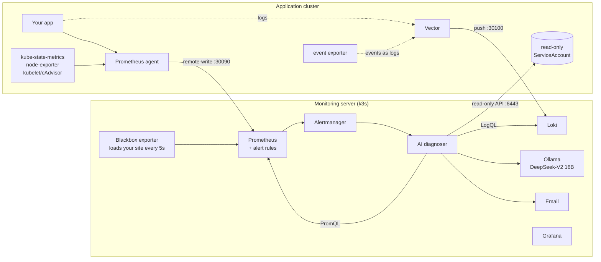

# incident-analysis

**Alerts that tell you *why*, not just *what*.**

`incident-analysis` is a self-hosted monitoring stack for Kubernetes where every alert arrives already investigated. When something breaks, it collects the evidence (metrics, logs, Kubernetes events, rollout history, ingress state, outside-in checks), works out the most likely root cause, and emails you a short, evidence-backed diagnosis — usually **within about a minute** of the failure.

```
[CRITICAL] Bad Deploy: deployment/api revision 14 rolled out 32s ago changed: api containerPort 'http' 8000 -> 800 (HIGH)

ROOT CAUSE   Recent deployment changed containerPort 'http' from 8000 to 800, so the new pod never becomes ready.
EVIDENCE     deployment/api revision 14 rolled out 32s ago changed: api containerPort 'http' 8000 -> 800
             new pod api-5db9d65984-cd9km: not Ready, restarts=0
             previous revision pods api-7ccb8bd7d-g94z8, api-7ccb8bd7d-zl7mk: all Ready and serving
             event Unhealthy x15: Startup probe failed: Get "http://10.244.126.186:800/healthz": connection refused
ACTION       kubectl -n shop rollout undo deployment/api
USER IMPACT  No user-facing errors measured right now (external checks pass, API error rate normal).
```

Everything runs on your own infrastructure: Prometheus, Loki, Grafana, Vector and a **local LLM through Ollama** (DeepSeek by default). No data leaves your servers.

---

## Why

Most alerts say *"HighErrorRate firing"* and leave the investigation to whoever is on call: open Grafana, grep logs, `kubectl describe`, check what was deployed. This project does that first pass automatically and puts the answer in the alert.

Two design rules keep it trustworthy:

1. **Evidence first, AI second.** A deterministic rule engine collects and scores the evidence. The evidence block in every email is generated from real data — never written by the model. The LLM only reasons over those facts and writes the explanation.
2. **The AI cannot touch your cluster.** It reads through a read-only Kubernetes identity (no secrets, no write verbs). Any command the model suggests that would change the cluster is dropped; the only "fix" command shown comes from the rule engine (e.g. `kubectl rollout undo` for a bad rollout).

## What it diagnoses

| Category | Typical cause | Key evidence it shows |
|---|---|---|
| Bad deploy | A rollout changed image/ports/env/probes and the new pods fail | exact field `old -> new`, new pods failing, old pods healthy |
| Image pull failure | Wrong tag, missing image, registry access | bad image vs last good image, `ErrImagePull` events |
| Ingress / routing | Backend service missing, host typo, TLS host mismatch | outside-in check status, "no ingress rule serves host X", Traefik 404 with no router |
| Crashloop / probe failure | Liveness/startup probes failing, restarts | probe failure messages, restarts, previous container logs |
| Memory leak / OOM | Memory grows until OOMKilled | working set vs limit, growth per 10 min, `OOMKilled` |
| CPU saturation | CFS throttling | CPU vs limit, throttled periods, latency |
| Database slowness | Slow queries, pool exhaustion | per-query p95 vs 1 h ago, pool waiting, longest active transaction, app CPU normal |
| Database errors | Query failures, DB unreachable | `db_errors_total` per query, error log lines |
| Application errors | 5xx with healthy infrastructure | 5xx ratio by route and pod, failures returning in < 1 ms, what was ruled out |
| Application latency | Slowness the DB can't explain | API p95 vs DB time, per-route latency |
| Node pressure, certificates, telemetry gaps | | node CPU/mem/disk, cert expiry, missing data |

If nothing in the evidence explains an alert, the email says **"No clear root cause found (LOW)"** instead of guessing.

## How it works



1. **Collect.** On the application cluster, a Prometheus agent scrapes everything and remote-writes it out; Vector ships every container log (and Kubernetes events) to Loki. Nothing heavy runs next to your app.
2. **Detect.** The monitoring server evaluates focused alert rules — including an outside-in check that loads your site like a user every 5 seconds, and kubelet probe-failure counters that catch bad rollouts in ~25 s.
3. **Investigate.** Alertmanager groups everything firing in a namespace into one incident and sends it to the diagnoser, which pulls evidence from Prometheus, Loki and the Kubernetes API in ~0.1 s.
4. **Reason.** A rule engine scores candidate root causes with supporting facts. The local LLM receives the top hypotheses and writes the root cause and actions (in a length-capped, schema-enforced format so it cannot ramble or truncate).
5. **Notify.** You get one email per incident, then a `RESOLVED` email when it clears. Every diagnosis is also stored in Loki and shown on the Grafana dashboard.

More detail: [docs/architecture.md](docs/architecture.md) · [docs/how-diagnosis-works.md](docs/how-diagnosis-works.md) · [docs/alerts.md](docs/alerts.md)

## Measured results

Tested against a three-tier demo app (nginx → FastAPI → Postgres) on a single-node kubeadm cluster, with the monitoring server on a separate 8 vCPU / 32 GB **CPU-only** VM:

| Failure injected | Diagnosis | Fault → email |
|---|---|---|
| Ingress backend points at a missing service | Ingress / routing (HIGH), names the missing service | **49 s** |
| Ingress host typo (one letter missing) | Ingress / routing (HIGH), flags the typo and TLS mismatch | **47 s** |
| `containerPort` changed 8000 → 800 | Bad deploy (HIGH), quotes the exact change | **63 s** |
| Image tag that doesn't exist | Image pull failure (HIGH), bad vs good image | ~3.5 min* |
| 30% of API requests return 500 | Application errors (HIGH) | ~3.5 min* |
| Every DB query 800 ms slower | Database slowness (HIGH) | — * |

\* measured before the faster detection settings; see [docs/testing.md](docs/testing.md). The LLM step takes ~25–30 s on CPU; with a GPU it drops to a few seconds.

## Quick start

**You need:** an application Kubernetes cluster you can `kubectl` into, and one Linux VM for monitoring (8 vCPU / 32 GB RAM / 50 GB disk recommended; no GPU required) in the same network, plus a DNS name for Grafana and an SMTP account (e.g. Gmail with an app password).

```bash
git clone https://github.com/sxvpexch/incident-analysis && cd incident-analysis
cp config.example.env config.env       # edit: namespace, IPs, domain, email, site URLs
```

**1. Application cluster** (kubectl pointing at it):
```bash
agent/install.sh                       # Prometheus agent, Vector, event exporter, read-only identity
```
This writes `secrets/app-cluster-token` and `secrets/app-cluster-ca.crt`; copy them to the monitoring server's `secrets/` directory.

**2. Monitoring server:**
```bash
monitoring-server/install-k3s.sh <private-ip>      # once
echo -n 'your-smtp-app-password' > secrets/smtp_password && chmod 600 secrets/smtp_password
monitoring-server/install.sh           # Prometheus, Alertmanager, Grafana, Loki, checks, Ollama, diagnoser
```

**3. Smoke test:**
```bash
scripts/diagnose-now.sh                # dry run: prints what an email would say right now
```

Full walkthrough including firewall ports, DNS and TLS: [docs/installation.md](docs/installation.md).

## Make your app diagnosable

The infrastructure categories (rollouts, image pulls, ingress, probes, OOM, CPU, nodes) work for any workload. For the application-level categories, the diagnoser looks for these conventions — anything missing is simply skipped:

| Signal | Expected shape |
|---|---|
| HTTP metrics | `http_requests_total{method,route,status}`, `http_request_duration_seconds` histogram with `route` |
| DB metrics | `db_query_duration_seconds` histogram with `query`, `db_errors_total{query}`, `db_pool_connections{state=size\|available\|waiting}` |
| Logs | one JSON line per request with `level`, `msg`, `route`, `status`, `duration_ms` |
| Labels | pods labelled `app.kubernetes.io/name` |
| Optional | `postgres-exporter`, nginx `stub_status` exporter ([agent/optional/](agent/optional/)) |

## Repository layout

```
config.example.env        one file that configures everything (copy to config.env)
agent/                    installed on the application cluster
monitoring-server/        installed on the monitoring server (Helm values, manifests, alert rules, dashboard)
diagnoser/                the AI diagnoser (single Python file, standard library only)
scripts/                  helpers: dry-run diagnosis, PromQL, incident timing harness
docs/                     architecture, diagnosis logic, alerts, installation, testing, lessons learned
```

## Configuration

All settings live in `config.env` (see [config.example.env](config.example.env) — every line is commented). Credentials live in `secrets/` and are git-ignored. To change the model, the alert thresholds or the diagnoser, edit and re-run the matching install script; they are idempotent.

Switch the AI between the lean (fast) and full answer format, or tune timeouts, with `LLM_MODE`, `LLM_MAX_TOKENS` and `LLM_TIMEOUT` in `config.env`, then run `diagnoser/deploy.sh`.

## Security notes

- The diagnoser uses a dedicated read-only ServiceAccount on the application cluster: `get`/`list` on workloads, events, pod logs and ingresses. No secrets, no ConfigMaps, no write access.
- Model output is never executed. Commands that change the cluster are filtered out of the AI's suggestions.
- All data stays on your servers: the LLM runs locally through Ollama.
- `config.env` and `secrets/` are git-ignored. Use an app password for SMTP, not your account password.

## Known limitations

- Single-node monitoring server; no HA or backups of Prometheus/Loki data.
- Tuned for one application namespace per installation (incidents are grouped per namespace).
- The LLM step is CPU-bound (~25–30 s on 8 vCPU). A GPU or a newer CPU generation makes it several times faster.
- Ingress checks are written for Traefik; other controllers work for the outside-in checks but not the Traefik log evidence.
- The diagnoser remembers already-emailed incidents in memory only; a restart can resend one email.

## Lessons learned

The interesting failures we hit while building this — why a reasoning model was 10× too slow on CPU, why Kubernetes events are a poor alert source, why `kubectl apply` silently did nothing after a rollback — are written up in [docs/lessons-learned.md](docs/lessons-learned.md).

## Questions and contributions

Questions, ideas or a failure mode it diagnosed badly? **Open an issue** — include the email it sent and what actually happened. Pull requests are welcome; see [CONTRIBUTING.md](CONTRIBUTING.md).

## License

[Apache License 2.0](LICENSE)
